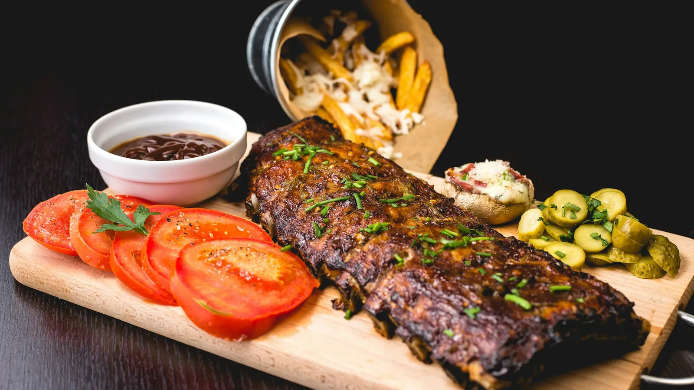

# 🌿 Le Menu Santé — Bistrot Parisien & Nutrition

A modern, nutrition-transparent menu catalog built for a contemporary French restaurant client. Customers can explore signature dishes, inspect every ingredient through an interactive circular plate presentation, view portion-accurate macronutrient figures (calories, protein, calcium), and understand daily dietary coverage.



---

## ✨ Key Features

- **Gourmet French Hospitality & Design**: Authentic Parisian bistro aesthetic using warm linen palettes, fine typography (*Playfair Display* & *Inter*), and subtle brass/gold accents.
- **Plate Composition & Fresh Ingredients View**: Interactive circular plating diagram with authentic photographs for each ingredient, portion weights in grams, and chef insight notes.
- **Micronutrient & Macronutrient Precision**: Calculates portion-accurate calories (kcal), protein (g), and calcium (mg) from standard biochemical tables (CIQUAL / USDA).
- **Daily Nutritional Need Coverage**: Visual progress bars mapping serving nutrients against standard adult 2,000 kcal dietary guidelines.
- **100% Bilingual (English & Français)**: Instant switch between English and French with zero page reloads; remembers preference in `localStorage`.
- **Adaptive Light & Dark Themes**: Follows OS `prefers-color-scheme` with instant manual toggle and persistence.
- **Zero Frameworks / Zero Build Step**: Pure HTML5, modern CSS3, and vanilla ES6+ JavaScript.

---

## 🍽️ Signature Menu

### Non-Vegetarian
1. **Artisanal Chicken Bun** (*Brioche Vapeur au Poulet*)
2. **Gourmet Beef Burger** (*Burger Gourmet au Bœuf*)
3. **Pan-Seared Salmon Fillet** (*Pavé de Saumon Rôti*)
4. **Wok-Tossed Prawn Fried Rice** (*Riz Sauté aux Crevettes Sauvages*)
5. **Rustic Mushroom Omelette** (*Omelette Rustique aux Champignons*)

### Vegetarian
6. **Four-Cheese Margherita Pizza** (*Pizza Artisanal Quatre-Fromages*)
7. **Provencal Chickpea Curry** (*Curry de Pois Chiches Provençal*)
8. **Grilled Paneer & Herb Wrap** (*Wrap de Paneer Grillé aux Fines Herbes*)
9. **Velvety Green Lentil Velouté** (*Velouté de Lentilles Vertes du Puy*)
10. **Creamy Truffled Mushroom Tagliatelle** (*Tagliatelles Crémeuses aux Champignons*)

---

## 📁 Project Structure

```
resturant-website/
├── index.html              # Clean semantic entrypoint
├── Le Menu Santé.html      # Local preview entrypoint
├── css/
│   └── style.css           # Mobile-first stylesheet (light/dark bistro themes)
├── js/
│   ├── data.js             # 21 ingredients & 10 signature dishes
│   ├── i18n.js             # English ↔ French localization engine
│   └── app.js              # State management & dynamic circular plate view
├── images/
│   ├── 1.webp ... 10.webp  # Dish photos (1200x900 WebP < 150 KB)
│   ├── 1-thumb.webp ...    # Card thumbnails (600x450 WebP)
│   ├── hero.webp           # Full-bleed restaurant hero photograph
│   ├── ingredients/        # 21 authentic ingredient photos (300x300 WebP)
│   └── CREDITS.md          # Photographer attributions & Unsplash license links
└── README.md
```

---

## 🚀 Deployment to GitHub Pages

1. Push this repository to GitHub.
2. In your repository on GitHub, navigate to **Settings** > **Pages**.
3. Under **Branch**, select `main` (or `master`) and directory `/ (root)`.
4. Click **Save**. Within 1–2 minutes, your website will be live worldwide!

---

## 📸 Image Credits

All food and ingredient photographs are original, high-resolution works sourced from [Unsplash](https://unsplash.com) under the free commercial Unsplash License. Detailed attributions and direct photographer links can be found in [`images/CREDITS.md`](images/CREDITS.md).
